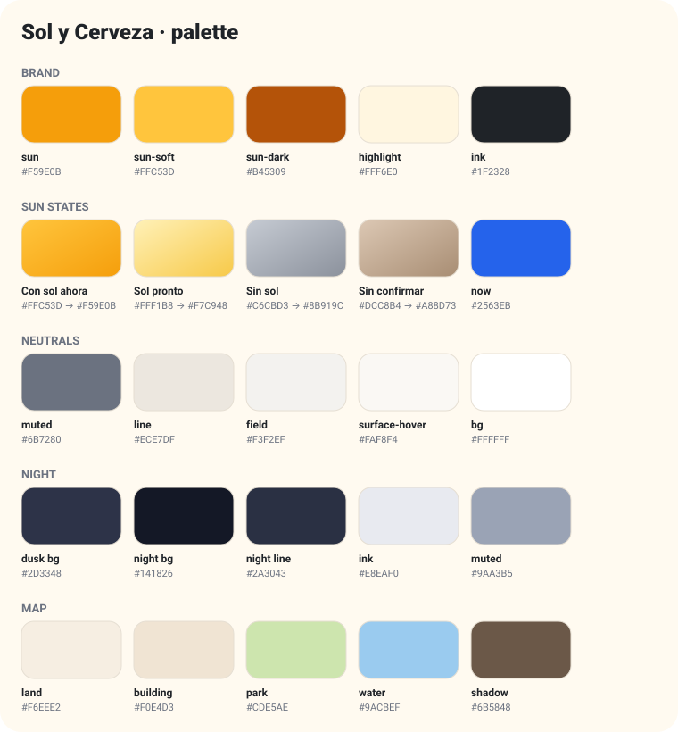

# Sol y Cerveza ☀️🍺

Which bar and restaurant terraces in Badajoz get sun or shade today, at any time of day.

- **Web:** <https://isroma.github.io/sol-y-cerveza/>
- **iOS / Android:** Capacitor shells exist, paused until the web version is polished

## How it works

```
pipeline/ (offline, Python)                         web/ (static, TypeScript)
venues + terrace positions ─┐
LiDAR surface model ────────┴─► horizon profile ──► web/public/data/ ──► sun position for the chosen
                                 per terrace (360°)   terraces.json       date/time vs. horizon → sun / shade
```

Shade is precomputed as each terrace's horizon: how high the surrounding buildings and trees rise in every direction. The app then only needs the sun's position, which it computes on the device. Details: [ADR-0001](docs/adr/0001-architecture.md) and the [data contract](docs/data-contract.md).

## Roadmap

The sun/shade map, the phone layout and the admin are live. What comes next (prices, verified terraces, seasonal trees) and why: [review and roadmap](docs/roadmap.md).

## Design

Brand, colours, typography, components, copy and templates: [design standards](docs/design/README.md).



## Development

You need Node 26 and [uv](https://docs.astral.sh/uv/).

```bash
cd web && npm ci && npm run dev        # web app on http://localhost:5173
cd pipeline && uv sync && uv run pytest
```

Browser smoke tests (Playwright, `web/e2e/`) drive the real app and map in Chromium, with a stubbed basemap and a small fixed data set, so they need no network. Install the browser once, then run them:

```bash
cd web && npx playwright install --with-deps chromium
npm run e2e                            # phone and desktop, against the Vite dev server
```

To rebuild the data (`web/public/data/terraces.json`) from `pipeline/`:

```bash
uv run python -m solycerveza.obstacles --source wcs   # surface + terrain rasters, once (see docs/research/lidar.md for the 2 m data)
uv run python -m solycerveza.leafoff                   # optional: leaf-off surface model for winter (ADR-0007)
uv run python -m solycerveza.build                     # venues + curated list + horizons -> terraces.json
```

### Seasonal trees

From 1 December to 15 March the app uses each terrace's `horizon_winter`: the horizon with deciduous tree crowns removed ([ADR-0007](docs/adr/0007-seasonal-trees.md)). `solycerveza.leafoff` builds it from the DSM, the DTM, OSM building footprints (Overpass) and a Sentinel-2 NDVI composite (public COGs on AWS, no account). It writes `pipeline/.cache/badajoz_dsm_leafoff.tif`. Without that file the build writes no winter horizons and the app behaves as before.

To check a rebuild:

1. `git diff --stat web/public/data/terraces.json`: count the terraces that gained a `horizon_winter` (the build also logs it). In the city centre, expect tens, not hundreds.
2. Open `pipeline/.cache/badajoz_dsm_leafoff.tif` and `badajoz_dsm.tif` in QGIS and look at their difference: only tree crowns should be lowered, never a roof, the city walls or the Alcazaba.
3. Pick 3–5 terraces you know: some under plane trees or mulberries (they should gain a winter horizon), and some under orange trees, palms or pines (they should not). Run the app with the clock in January (or the admin probe) and compare.
4. If evergreens come out as bare, raise `WINTER_DROP_MIN_NDVI` in `pipeline/src/solycerveza/leafoff.py`. If plane-tree squares are missed, lower it, or `SUMMER_MIN_NDVI`. Say what you changed in the PR.

The app icons in the web manifest (`web/public/icon-*.png`) and the link preview image (`web/public/og.png`) come from `web/public/favicon.svg`: regenerate them with `cd web && node scripts/brand-images.mjs` (needs Playwright's Chromium).

### Fixing a terrace

`cd web && npm run admin` opens the dev-only admin. It needs the LiDAR rasters in `pipeline/.cache/` (from `solycerveza.obstacles` above) for the sun preview; everything else works without them.

1. Pick **Needs a look**: terraces whose current horizon gets no sun today, on 21 Jun or on 21 Dec, or is above 60° over most of the southern half. Usually the pin is against a wall, under a tree crown or on a roof.
2. Click one, press **T** and click (or drag the pin to) where the tables stand. The panel's **Sun at the terrace pin** updates as you go: today's hours of sun, a 24 h strip (amber sun, grey shade, light night) and the **height above ground** at the pin.
3. Read it:
   - **No sun** while the tables do get sun: the pin is in the shade of something the tables are not, typically tight against a façade or under a crown. Move it a few metres onto open ground, towards the middle of the tables.
   - **Height above ground** is the surface model minus the terrain under the pin. On the street it reads about 0 m. Above 2 m (the build's warning threshold) the pin sits on a roof, an awning or a tree crown, and its horizon is meaningless: move it to the pavement or square below.
4. **Publish** when done. The list is computed from the published `terraces.json`, so a fixed terrace leaves it after the next build ("pin moved since the build" until then).

### Prices from venue websites

```bash
cd pipeline && uv run python -m solycerveza.price_candidates   # --refresh to download the pages again
```

It reads the venues' own websites (never social networks, review sites or delivery apps), honouring robots.txt, and writes the caña and tercio prices it is sure about, with the page and the text they came from, to `pipeline/data/price_candidates.csv`. These are candidates: nothing reaches the app until you accept one, which copies it into `venue_prices.csv`. Menus published as PDF or image files are listed in `pipeline/.cache/menu_leads.csv` to read by hand. See [ADR-0006](docs/adr/0006-price-candidates-from-venue-websites.md).

Every change goes through a PR with green CI. [CLAUDE.md](CLAUDE.md) has the workflow, the quality gates and the conventions.

## Data and attribution

- Map data © [OpenStreetMap](https://www.openstreetmap.org/copyright) contributors (ODbL). Basemap tiles by [OpenFreeMap](https://openfreemap.org).
- More venues from [Overture Maps](https://overturemaps.org) (CDLA-Permissive-2.0, [licence text](web/public/data/licenses/CDLA-Permissive-2.0.txt)); see [ADR-0003](docs/adr/0003-venue-base-osm-plus-overture.md).
- Venues from the Junta de Extremadura's restaurant register (CC BY 4.0), geocoded with CartoCiudad (CC BY 4.0 ign.es); see [ADR-0004](docs/adr/0004-junta-register-and-website-evidence.md).
- Terrace positions placed on the PNOA orthophoto © IGN (CC-BY 4.0).
- Surface and terrain models (PNOA-LiDAR 2nd coverage, flown 2018–19, 2 m): `Obra derivada de MDS02 2015-2021 CC-BY 4.0 scne.es` and `Obra derivada de MDT02-cob2 2015-2021 CC-BY 4.0 scne.es` (IGN/CNIG); [details](docs/research/lidar.md).
- Deciduous trees for the winter horizons (when built): `Contiene datos modificados de Copernicus Sentinel (2025)` (Sentinel-2 L2A, Copernicus open licence); [ADR-0007](docs/adr/0007-seasonal-trees.md).

## License

Code is MIT. `web/public/data/terraces.json` contains OpenStreetMap data and is released under the [ODbL](https://opendatacommons.org/licenses/odbl/); its other sources are credited inside the file ([data sources](docs/research/data-sources.md), [ADR-0002](docs/adr/0002-terrace-data-sources.md)).
