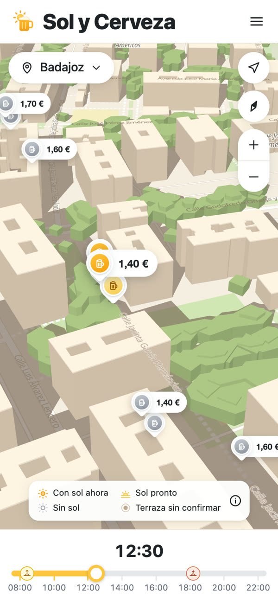
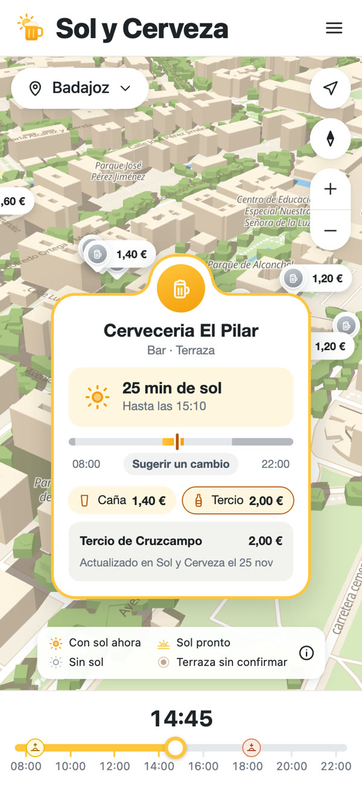
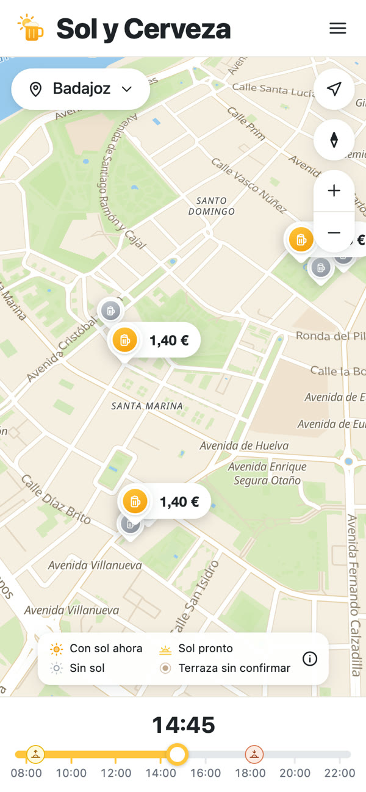

<div align="center">


# Sol y Cerveza

**Which terraces in Badajoz are in the sun right now — and what a caña costs there.**

[](https://github.com/isroma/sol-y-cerveza/actions/workflows/ci.yml)
[](https://isroma.github.io/sol-y-cerveza/)
[](LICENSE)
[](#license)

[**Open the app**](https://isroma.github.io/sol-y-cerveza/) · [Watch the 23 s demo](https://github.com/isroma/sol-y-cerveza/releases/tag/demo-2026-11) · [Roadmap](docs/roadmap.md) · [Contributing](CONTRIBUTING.md)

&nbsp;
&nbsp;


</div>

## Features

- ☀️ **Sun or shade, terrace by terrace**, for today at any time: drag the time bar and watch the shade move.
- 🏙️ **A 3D map** of Badajoz's buildings and trees from LiDAR, with their shadows cast on the GPU.
- 🍺 **Beer prices** — a caña and tercios by brand — from the owner or agreed by visitors.
- 🗺️ **Every terrace's day at a glance**: when the sun comes, how long it stays.
- ✍️ **Suggest a change** from any card: a price, a moved or closed venue, a missing bar.
- 📴 **Works offline** for the areas you've already seen.

## How it works

```
pipeline/ (offline, Python)                         web/ (static, TypeScript)
venues + terrace positions ─┐
LiDAR surface model ────────┴─► horizon profile ──► web/public/data/ ──► sun position today at the
                                 per terrace (360°)   terraces.json       chosen time vs. horizon → sun / shade
```

Shade is precomputed as each terrace's horizon: how high the surrounding buildings and trees rise in every direction. The app then only needs the sun's position, which it computes on the device. Prices, suggestions and reports go through a small API (`api/`, a Cloudflare Worker). More in [ADR-0001](docs/adr/0001-architecture.md) and the [data contract](docs/data-contract.md).

## Quick start

You need Node 26 and [uv](https://docs.astral.sh/uv/).

```bash
cd web && npm ci && npm run dev        # http://localhost:5173
```

Local API, admin, owner mode and browser tests: [development guide](docs/development.md).

## Project

|             |                                                               |
| ----------- | ------------------------------------------------------------- |
| `web/`      | The app: Vite, React, TypeScript, MapLibre GL JS              |
| `pipeline/` | Offline data build: venues, terraces, LiDAR horizons (Python) |
| `api/`      | Prices, suggestions and reports: Cloudflare Worker + D1       |
| `docs/`     | Guides, design standards, architecture decisions, research    |

**Status:** the sun/shade map, prices, suggestions, offline use and the admin are built; the iOS and Android shells are paused. What's next: [roadmap](docs/roadmap.md).

## Documentation

| Guide                                                                                                              | What's in it                                                    |
| ------------------------------------------------------------------------------------------------------------------ | --------------------------------------------------------------- |
| [Development](docs/development.md)                                                                                 | Running everything locally, tests, the admin and owner mode     |
| [Design standards](docs/design/README.md)                                                                          | Brand, palette, typography, components, copy                    |
| [Pipeline](docs/pipeline.md)                                                                                       | Building `terraces.json`, LiDAR, seasonal trees, OSM write-back |
| [Admin](docs/admin.md)                                                                                             | Curating venues, terraces and prices; Publish                   |
| [API](api/README.md)                                                                                               | Endpoints, guardrails, deploys                                  |
| [Operations](docs/operations.md)                                                                                   | Deploys, secrets, the service worker, CI                        |
| [Data contract](docs/data-contract.md) · [ADRs](docs/adr/) · [Research](docs/research/) · [Mobile](docs/mobile.md) |                                                                 |

## Privacy

The app has a short privacy notice in Spanish: the "i" in the map's legend, then **Privacidad** (`web/src/ui/PrivacyNotice.tsx`). In English:

- **Controller.** Sol y Cerveza is a personal, non-commercial project by its author, the GitHub account [isroma](https://github.com/isroma). Questions and requests go to the [repository's issues](https://github.com/isroma/sol-y-cerveza/issues).
- **No cookies, no visitor accounts, no advertising or tracking.** The browser keeps a copy of the app, its data and the map tiles (the service worker's caches) so it opens fast and offline; nothing that identifies you. The only other browser storage is a timestamp in session storage that stops a reload loop after a failed update, and, for the owner only, the owner-mode login token.
- **Location.** The locate button only centres the map on your device; the position is never sent. Like any web map, it downloads the tiles of the area on screen.
- **Anonymous usage counters**, so we can improve the app, as daily totals only: page loads (phone or desktop), venue cards opened (which venue), the hour picked on the time bar, filters switched on, and whether the card's back, search, the locate button, "¿Falta un bar?" or a suggestion were used. Nothing is stored in your browser for this and no identifier is sent, and what is sent never includes what you type or where you are. Our database keeps only the daily totals: no IP address, browser, referring page or anything that ties one count to another. With Global Privacy Control or Do Not Track on, the app counts nothing. Details: [ADR-0013](docs/adr/0013-anonymous-usage-counters.md).
- **When you send something** (a price, a change to a venue or a missing bar, "the sun is on this terrace now"), the API stores what you sent, when, and two salted hashes (keyed with a Worker secret): one of your IP address (IPv4, or the IPv6 /64) and one of your network (/24 or /48), never the address itself. They prevent abuse and keep one person from counting more than once (legitimate interest). They are kept while they serve that and the consensus, and deleted on request; there is no automatic purge yet. The log behind the daily caps is pruned after 48 hours ([api/README.md](api/README.md#spam-and-bot-guardrails)). An owner login attempt at `/admin` stores a hash of the network for a day.
- **Publication.** Prices and sun that several visitors agree on are shown in the app; what the owner accepts (a price, a move, a new bar) is published in the app and in this public repository, with nothing about who sent it.
- **Providers** that see your IP address because they serve the requests: GitHub Pages (the site), OpenFreeMap (the map tiles and fonts), Cloudflare (the API Worker). The bot check (Turnstile) is Cloudflare's own service, loaded only when a form that sends something opens. GitHub and Cloudflare are US companies and may process data outside the EU, under the safeguards their own privacy policies describe. The Worker keeps no per-request invocation logs (`invocation_logs = false` in `api/wrangler.toml`); entries for errors (`console.error`, uncaught exceptions) remain in Workers Logs and may carry Cloudflare's own request metadata, which we have not inspected. GitHub and Cloudflare also run their own infrastructure logs, which we don't control.
- **Your rights.** Access, rectification, erasure, restriction, objection and portability through the contact above (tell us what you sent and when, so we can find it); complaints to the Spanish data protection authority, the AEPD ([www.aepd.es](https://www.aepd.es)).

Keep the notice and this section true: when what the app stores, sends or what the API keeps changes, update both in the same PR.

## Contributing

Spotted a wrong or missing terrace? You don't need GitHub: open it in [the app](https://isroma.github.io/sol-y-cerveza/) and use **Sugerir un cambio**. For code, see [CONTRIBUTING.md](CONTRIBUTING.md); every change goes through a PR with green CI.

## Credits and license

Code is [MIT](LICENSE). `terraces.json` and the map's `buildings.json` contain OpenStreetMap data and are [ODbL](https://opendatacommons.org/licenses/odbl/).

<details>
<summary>Data sources and attribution</summary>

- Map data © [OpenStreetMap](https://www.openstreetmap.org/copyright) contributors (ODbL). Basemap tiles by [OpenFreeMap](https://openfreemap.org). The service worker keeps a bounded copy of the basemap files a visitor has already loaded in that visitor's browser (at most 600 files, 30 days), so areas already seen work offline; the project does not store or redistribute them.
- More venues from [Overture Maps](https://overturemaps.org) (CDLA-Permissive-2.0, [licence text](web/public/data/licenses/CDLA-Permissive-2.0.txt)); see [ADR-0003](docs/adr/0003-venue-base-osm-plus-overture.md).
- Venues from the Junta de Extremadura's restaurant register (CC BY 4.0), geocoded with CartoCiudad (CC BY 4.0 ign.es); see [ADR-0004](docs/adr/0004-junta-register-and-website-evidence.md).
- Terrace positions placed on the PNOA orthophoto © IGN (CC-BY 4.0).
- Surface and terrain models (PNOA-LiDAR 2nd coverage, flown 2018–19, 2 m): `Obra derivada de MDS02 2015-2021 CC-BY 4.0 scne.es` and `Obra derivada de MDT02-cob2 2015-2021 CC-BY 4.0 scne.es` (IGN/CNIG); [details](docs/research/lidar.md).
- Deciduous trees for the winter horizons (when built): `Contiene datos modificados de Copernicus Sentinel (2025)` (Sentinel-2 L2A, Copernicus open licence); [ADR-0007](docs/adr/0007-seasonal-trees.md).

Other sources are credited inside the data file ([data sources](docs/research/data-sources.md), [ADR-0002](docs/adr/0002-terrace-data-sources.md)).

</details>
