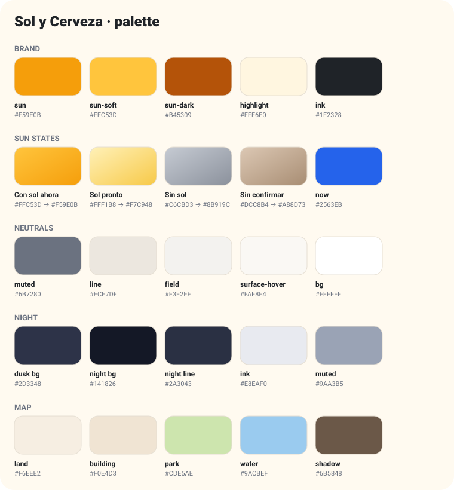

# Sol y Cerveza design standards

The reference for how Sol y Cerveza looks, sounds and behaves. Use it before adding a screen, a component, a colour or a piece of copy. The live product is the source of truth for anything this document doesn't cover; if they disagree, fix one of them in the same PR.

- Palette at a glance: [`palette.svg`](palette.svg)
- Machine-readable tokens: [`tokens.json`](tokens.json) (mirrors `web/src/styles/` (`tokens.css`, `night.css`), `web/src/ui/categoryStyle.ts`, `web/src/map/mapStyle.ts` and `web/src/map/night.ts`)

## 1. Brand

**Idea:** the terrace that still has sun. A friendly local guide that answers one question in one glance: _where can I sit in the sun with a beer right now, and for how long?_

**Personality:** sunny, relaxed, local, precise. Warm like a Badajoz afternoon, but honest about the numbers: we show minutes of sun, not vague promises.

| We are                           | We are not                        |
| -------------------------------- | --------------------------------- |
| Warm and light-hearted           | Childish or jokey                 |
| Local (Badajoz first)            | Generic "city guide"              |
| Precise (real sun, real minutes) | Technical or data-heavy in the UI |
| Calm, map-first                  | Loud, ad-like, cluttered          |

### Name and logo

- The name is always **Sol y Cerveza**: capital S and C, lowercase "y", never abbreviated. In the repo and code it stays in Spanish; everything else in the repo is English.
- The mark is a **sun rising behind a pint** (`Logo` in `web/src/ui/icons.tsx`, `web/public/favicon.svg`):
  - sun `#FFC53D` with rays `#F5A623`, five rays from top to bottom-left;
  - glass `#FFB020` with a soft amber gradient, foam `#FFF8E7`.
- Use the mark next to the wordmark in the header (44 px). The mark alone is for favicons, app icons and avatars.
- Keep clear space of at least half the mark's width around it. Don't recolour it, add outlines, stretch it or put it on busy imagery; on dark backgrounds use it as-is (it is designed to work on both).

## 2. Voice and copy

The app speaks **Spanish (Spain)**; the repo is English.

- Talk to the user as **tú**, short and direct: "Con sol ahora", "Sol pronto", "Sin más sol hoy".
- Lead with the answer, then the detail: **"1 h 9 min de sol"** then "Hasta las 17:40".
- Times are 24 h, `HH:MM` ("17:40"); durations are "2 h 5 min", "45 min" (no seconds, no "minutos").
- Prices (when they exist) follow Spanish format: **"2,50 €"**.
- Sentence case everywhere ("Solo con terraza", not "Solo Con Terraza").
- Be honest about data: unverified things say so ("Posición sin verificar", "Terraza sin confirmar"). Never show made-up values.
- No exclamation marks in the UI (the one exception is the thank-you after sending a price or a report: "¡Gracias! …"), no emoji in product copy. Emoji are fine in social posts (one per post, ☀️ or 🍺).

**Glossary** (always these words):

| Concept                       | UI copy                                                     |
| ----------------------------- | ----------------------------------------------------------- |
| In sun now                    | Con sol ahora                                               |
| Sun within the hour           | Sol pronto                                                  |
| No more sun today             | Sin sol / Sin más sol hoy                                   |
| Venue without a known terrace | Terraza sin confirmar                                       |
| Sun left                      | "2 h 5 min de sol"                                          |
| Sun until                     | "Hasta las 17:40"                                           |
| Sun coming                    | "Sol en 25 min" / "Desde las 14:57"                         |
| Night                         | De noche                                                    |
| Suggest a change to a venue   | Sugerir un cambio                                           |
| Ask about a terrace           | ¿Tiene terraza? Sí / No (front); Tiene terraza (back)       |
| Where the tables are          | Mover mesas; ¿Dónde están las mesas?                        |
| Report a missing venue        | + Añadir; ¿Falta? Añádelo                                   |
| Report sent                   | ¡Gracias! Lo revisaremos antes de publicarlo.               |
| Sun seen by visitors          | "~1 h 9 min de sol" · Según los visitantes                  |
| Report sun here now           | Ahora mismo da el sol                                       |
| Sun report sent               | ¡Gracias! Marcaremos el sol cuando tres personas coincidan. |

## 3. Colour

Colour carries meaning here: **yellow means sun**. Keep it for sun and for the one primary action; don't use it as decoration.

### Brand and sun

| Token       | Hex       | Use                                                                          |
| ----------- | --------- | ---------------------------------------------------------------------------- |
| `sun`       | `#F59E0B` | Sunny state, icons, gradients' deep end. **Never as text on white** (2.2:1). |
| `sun-soft`  | `#FFC53D` | Primary accents: slider fill, toggles on, selected chips, card border.       |
| `sun-dark`  | `#B45309` | Sun-coloured **text** and small icons on light backgrounds (5.0:1).          |
| `chip`      | `#FFC83D` | Selected chips and pills. Text on it is `ink` (10:1).                        |
| `highlight` | `#FFF6E0` | Soft sunny surfaces: selected list row, sun box in the map card.             |

### Sun states (map badges, legend, list icons)

Every badge is a 160° gradient, light to deep, with a 2 px white ring.

The line icons for `sun` and `soon` (legend, list, filters, card) fill their disc with their own colour at 50 %, so the yellow and orange read at small sizes; `nosun` stays an outline.

| State     | Copy                  | Solid     | Badge gradient                      | Size                                       |
| --------- | --------------------- | --------- | ----------------------------------- | ------------------------------------------ |
| `sun`     | Con sol ahora         | `#F59E0B` | `#FFC53D → #F59E0B`                 | 100 % (highlighted when zoomed out: 112 %) |
| `soon`    | Sol pronto            | `#F7C948` | `#FFF1B8 → #F7C948`, icon `#A16207` | 100 %                                      |
| `nosun`   | Sin sol               | `#9CA3AF` | `#C6CBD3 → #8B919C`                 | 78 % (56 % zoomed out)                     |
| `unknown` | Terraza sin confirmar | `#B59A80` | `#DCC8B4 → #A88D73`                 | 78 % (56 % zoomed out)                     |

Rules: sunny badges always sit above grey ones; only sunny terraces are ever enlarged; taupe is reserved for "unconfirmed" so it never reads as "no sun".

**A terrace partly in sun is in sun** (`docs/data-contract.md`, "Horizon envelope"): where the data samples several points across a terrace, it counts as sun as soon as any of them gets sun, and looks exactly like sun everywhere (badge, list, card, day strip, sort, "Con sol ahora"). "Sol hasta las …" is when the last of the terrace loses the sun, "Sol en …" when the first of it gets sun. There is no separate partial state. Terraces without an envelope keep the single-point answer.

**Short shade counts as sun** (`fillShortShade` in `web/src/sun/sunState.ts`): shade under 20 minutes (`SHORT_SHADE_UNDER_MINUTES`; with 5-minute steps, up to 3 steps or 15 minutes) between two sunny stretches is sun everywhere: the badge state, "Con sol ahora", "Sol hasta las …", the minutes of sun and the day strip. Such gaps are mostly noise in the surface model (a lamp post, the edge of a crown). Shade before the first sun and after the last is unchanged, and longer gaps stay (Kiosco Silva's 25 minutes behind a tower).

**Sun visitors saw counts as sun, marked "~"** (issue #364, [ADR-0012](../adr/0012-sun-reports.md), `web/src/sun/corrections.ts`): where 3 visitors on different networks said "Ahora mismo da el sol" the model says shade, the app shows sun everywhere (badge, list, filters, card, day strip), like a visitors' price, and says it is their estimate in three quiet places only: the card's headline puts "~" before the duration ("~1 h 9 min de sol", "Sol en ~25 min") with a third line "Según los visitantes" (12 px `muted`) under "Hasta las …"; the list's caption does the same ("Sol hasta las 16:10 (~3 h 10 min)"); and the day strip draws that sun in stripes (below). The mark shows when the sun spell the headline talks about (the current one, or the next) has any such step. It is not a new state: no new colour, icon or legend row. Once the owner confirms a report, its sun looks like any other sun.

### Neutrals (day)

| Token           | Hex       | Use                              |
| --------------- | --------- | -------------------------------- |
| `ink`           | `#1F2328` | Primary text (15.8:1 on white)   |
| `text-soft`     | `#4B5563` | Secondary icons and controls     |
| `muted`         | `#6B7280` | Secondary text, captions (4.8:1) |
| `placeholder`   | `#8A8F98` | Input placeholders only          |
| `line`          | `#ECE7DF` | Dividers, borders                |
| `field`         | `#F3F2EF` | Input and search fields          |
| `toggle-off`    | `#E5E7EB` | Off toggles, empty tracks        |
| `surface-hover` | `#FAF8F4` | Hover on rows and buttons        |
| `bg`            | `#FFFFFF` | App and card surfaces            |

### Night

The whole app goes dark while the sun is down, graded by how deep the night is: **dusk** (sun just set) is a soft blue hour, **deep night** (sun 18° below the horizon) is the darkest. Values in between are mixed (`nightDepth`, `color-mix`).

| Token   | Dusk      | Deep night         |
| ------- | --------- | ------------------ |
| `bg`    | `#2D3348` | `#141826`          |
| `field` | `#383F56` | `#1D2231`          |
| `line`  | `#434A62` | `#2A3043`          |
| `ink`   | `#E8EAF0` | `#E8EAF0` (14.7:1) |
| `muted` | `#9AA3B5` | `#9AA3B5` (7:1)    |

Sun colours don't change at night; they glow on the dark map. Pins and slider knobs stay white.

### Map (day)

Apple Maps-like and warm. The map is the stage, not the star: low contrast, so the badges pop.

| Layer            | Hex                                                                                                                                                                                                                                             |
| ---------------- | ----------------------------------------------------------------------------------------------------------------------------------------------------------------------------------------------------------------------------------------------- |
| Land             | `#F6EEE2`                                                                                                                                                                                                                                       |
| Residential      | `#F1E5D2`                                                                                                                                                                                                                                       |
| Buildings (flat) | `#F0E4D3`, outline `#E5D5BF`                                                                                                                                                                                                                    |
| Buildings (3D)   | walls `#F2E6D6`, roof caps `#FCF8F1`, soft warm light, antialiased; OSM outlines at their LiDAR heights, true to scale (no exaggeration). Until they load, or offline without them, the basemap's buildings at its own heights, without shadows |
| Parks            | `#CDE5AE`                                                                                                                                                                                                                                       |
| Water            | `#9ACBEF`                                                                                                                                                                                                                                       |
| Streets          | `#FFFFFF`, casing `#E4D6C3` (major `#E6CFA8`)                                                                                                                                                                                                   |
| Shadows          | `#6B5848`, 0 → 0.6 opacity as the view tilts; flat, crisp polygons cast on the GPU from the LiDAR buildings and tree crowns the map draws, so every shadow has a visible caster; one tone where they overlap; at most 300 m long                |
| Trees (3D)       | `#A8C98C`, LiDAR crowns in height bands; dusk `#4B5E50`, night `#22302A`. From 1 Dec to 15 Mar (when the data has winter horizons), deciduous crowns are bare: `#C5CCB3`, and cast no shadow                                                    |
| Labels           | `#7A6B55` / `#8A7B66`, water `#4D8BC4`                                                                                                                                                                                                          |

Night map palettes: see `DUSK` and `NIGHT` in `web/src/map/night.ts` and [`tokens.json`](tokens.json).

## 4. Typography

One family: the **system UI font** (SF Pro on Apple, Segoe UI on Windows, Roboto on Android), with Inter as the web fallback. Map labels use the basemap's Noto Sans.

| Style       | Size / weight                | Use                                 |
| ----------- | ---------------------------- | ----------------------------------- |
| Display     | 30 px / 800                  | App title "Sol y Cerveza"           |
| Clock       | 34 px / 700, tabular numbers | Chosen time (24 px on phones)       |
| Title       | 17–20 px / 800               | Card titles, sun box headline       |
| Body strong | 15–16 px / 600               | List names, legend, filters         |
| Body        | 15–16 px / 400               | Default text (line height 1.4)      |
| Caption     | 13 px / 400, `muted`         | Secondary lines ("Hasta las 17:40") |
| Small       | 11–12 px                     | Slider ticks, notes, attribution    |

Numbers that change (times, durations, prices) use `font-variant-numeric: tabular-nums` so they don't jump.

## 5. Layout, space and depth

Spacing follows a **4-point grid**, and every value comes from the tokens in `web/src/styles/tokens.css` (`--space-*`, `--radius-*`, `--control`, `--map-inset`). If a value isn't on the scale, it's wrong.

| Token       | Value | Typical use                                          |
| ----------- | ----- | ---------------------------------------------------- |
| `--space-1` | 4 px  | Tight inner gaps, menu padding                       |
| `--space-2` | 8 px  | Label to control, list title to list, small paddings |
| `--space-3` | 12 px | Icon to text in rows, legend rows, map button gap    |
| `--space-4` | 16 px | Panel and card padding, map overlay inset            |
| `--space-5` | 20 px | Above a sidebar section (filters, results)           |
| `--space-6` | 24 px | Sidebar padding and the gap between sidebar blocks   |
| `--space-8` | 32 px | Reserved for large separations                       |

**Radius:** `--radius-s` 8 px (small buttons), `--radius-m` 12 px (fields, rows, notices), `--radius-l` 16 px (floating panels, menus, legend), `--radius-xl` 24 px (cards); 999 px for pills, toggles and tracks; 50 % for round buttons and badges.

### Sidebar

- 400 px wide, **24 px padding** on every side, **24 px between blocks** (brand, search, time, filters, results).
- Sections that follow a divider (filters, results) start **20 px** below it.
- Search field: at least **48 px** tall, 12 px radius, icon 16 px from the left edge, text starting at 44 px.
- List rows: 10 px × 12 px padding, 12 px icon-to-text gap. The list bleeds 12 px past the sidebar padding, so **row content lines up with every other element's left edge** and the selected row's highlight extends past it, as in iOS grouped lists.
- Filter rows: 8 px vertical padding, 12 px gap, toggle aligned to the right edge.

### Phones (under 900 px)

- A slim brand bar on top (32 px mark, 20 px title) with a **menu button** (44 px) on the right.
- The map fills the middle and the **time bar is the footer**, always in view.
- The menu opens over the map, between the brand bar and the footer, with search, filters and the list. The button turns into a close icon; Escape or picking a venue closes it, so the venue's map card shows.
- The legend (as wide as its rows, 56 px tall) is centred at the bottom of the map; it steps aside while a venue card shows its back (Sugerir un cambio), so the card has the room down to the time bar.
- While the report picker is open (§7), the time footer and that bottom group are hidden: the picker's bar takes the bottom of the map, centred. On desktop the bar sits bottom-left (16 px inset, at most 420 px wide), clear of the legend.

### Map overlays

- Everything floating on the map sits on one **16 px inset** (`--map-inset`): city pill top-left, buttons top-right, legend bottom-right.
- Map buttons and the city pill are **44 px tall** (`--control`, Apple's minimum touch target); buttons are round, the zoom pair is one 44 px-wide capsule; **12 px** between button groups.
- Toasts appear 12 px under the top controls.
- Map attribution: no MapLibre attribution control. The legend's "i" is the only info button, in its top-right corner (mirroring the first row's sun icon on desktop, centred on the strip on phones); its "Sobre los datos" panel (13 px) is one paragraph (how sun and shade are worked out, the winter-trees rule when the data has it, and "Puede haber errores") over the credits as one run of 11 px `muted` small print, "·" between them: the basemap credits (OpenFreeMap, OpenMapTiles, OpenStreetMap, as links), then the data licence lines. It fits whole, with no scrolling, from a 375 × 667 phone up.
- Legend: 16 px padding, 12 px between rows and between icon and label, 16 px radius; the info button is centred on the last row, 12 px from the right edge.
- Info panel: 16 px padding and radius, opens 12 px above the legend, at most 340 px wide: right-aligned with it on desktop, centred on phones.
- Admin pill (owner mode only, never seen by visitors): after the name in the header, styled like the card's "Sugerir un cambio" (ink at 6 % on the background, `text-soft`, 13 px semibold, 28 px high). On phones it is 12 px and 26 px high. On both, it sits 12 px after the name and 3 px below the line's middle, centred on the name's lowercase letters; the header keeps its spacing, so the name and the menu button don't move when the pill appears. It opens a `bg` panel with `--shadow` under the header, titled "Admin" with a 32 px muted cross at the top right that closes it (no Cancelar or Cerrar buttons): the login (Usuario, and Contraseña with an eye button inside that shows or hides it, on `field`; and "Iniciar sesión" in the primary style: `sun-soft`, ink, bold) at `/admin`, or "Cerrar sesión" in the same primary style. Owner mode has no other UI: the card's back says "Editar" and "Guardar" instead of "Sugerir un cambio" and "Enviar", with no bot check.
- The admin page (`admin.html`, dev only, never built) keeps its own plain palette (`web/src/admin/admin.css`). Its **Orthophoto** basemap toggle sits top-right on the map with the PNOA credit under it while on; on phones, where the list stacks above the map, both sit bottom-left side by side, clear of MapLibre's attribution.

### Depth and borders

- **Shadows:** one soft shadow for floating UI (`--shadow`: `0 4px 16px rgba(31,35,40,.10), 0 1px 3px rgba(31,35,40,.08)`); stronger only for the map card. At night shadows are black and deeper.
- **Borders:** 1 px `line` for dividers; a 3 px border in the state colour only on the selected map card.

## 6. Iconography

- Line icons, 24 px grid, **2 px stroke**, round caps and joins, `currentColor`. They live in `web/src/ui/icons.tsx`; add new ones there in the same style.
- Sun states have their own icons: full sun (con sol), sun on the horizon (sol pronto), faded sun (sin sol), sunrise/sunset (sun on the horizon with an arrow up/down).
- The **beer mug** is the venue symbol: it appears inside every map badge and the map card.
- Icons are 20–24 px in the UI, 12–16 px inside badges and slider marks.

## 7. Components

| Component           | Standard                                                                                                                                                                                                                                                                                                                                                                                                                                                                                                                                                                                                                                                                                                                                                                                                                                                                                                                                                                                                                                                                                                                                                                                                                                                                                                                                                                                                                                                                                                                                                                                                                                                                                                                                                                                                                                                                                                                                                                                                                                                                                                                                                                                                                                                                                                                                                                                                                                                                                                                                                                                                                                                                                                                                                                                                                                                                                                                                                                                                                                                                                                                                                                                                                                                                                                                                                                                                                                                                                                                                                                                                                                                                                                                                                                                                                                                                                                                                                                                                                                                                                                                                                                                                                                                                                                                                                                                                                                                                                                                                                                                                                                                                                                                                                                                                                                                                                                                                                                             |
| ------------------- | ------------------------------------------------------------------------------------------------------------------------------------------------------------------------------------------------------------------------------------------------------------------------------------------------------------------------------------------------------------------------------------------------------------------------------------------------------------------------------------------------------------------------------------------------------------------------------------------------------------------------------------------------------------------------------------------------------------------------------------------------------------------------------------------------------------------------------------------------------------------------------------------------------------------------------------------------------------------------------------------------------------------------------------------------------------------------------------------------------------------------------------------------------------------------------------------------------------------------------------------------------------------------------------------------------------------------------------------------------------------------------------------------------------------------------------------------------------------------------------------------------------------------------------------------------------------------------------------------------------------------------------------------------------------------------------------------------------------------------------------------------------------------------------------------------------------------------------------------------------------------------------------------------------------------------------------------------------------------------------------------------------------------------------------------------------------------------------------------------------------------------------------------------------------------------------------------------------------------------------------------------------------------------------------------------------------------------------------------------------------------------------------------------------------------------------------------------------------------------------------------------------------------------------------------------------------------------------------------------------------------------------------------------------------------------------------------------------------------------------------------------------------------------------------------------------------------------------------------------------------------------------------------------------------------------------------------------------------------------------------------------------------------------------------------------------------------------------------------------------------------------------------------------------------------------------------------------------------------------------------------------------------------------------------------------------------------------------------------------------------------------------------------------------------------------------------------------------------------------------------------------------------------------------------------------------------------------------------------------------------------------------------------------------------------------------------------------------------------------------------------------------------------------------------------------------------------------------------------------------------------------------------------------------------------------------------------------------------------------------------------------------------------------------------------------------------------------------------------------------------------------------------------------------------------------------------------------------------------------------------------------------------------------------------------------------------------------------------------------------------------------------------------------------------------------------------------------------------------------------------------------------------------------------------------------------------------------------------------------------------------------------------------------------------------------------------------------------------------------------------------------------------------------------------------------------------------------------------------------------------------------------------------------------------------------------------------------------------------------------ |
| **Map badge**       | A white teardrop (map-pin shape, the pointer leaving the circle on tangents) around a round gradient badge with the beer mug, with a soft shadow. Selected, it gets a 3 px ring in the state colour, the same as the card's border. Shows only the badge until real prices exist; the price slot then sits to its right in bold `ink`. **Caña price:** a badge with a caña price gets a white tab out to its right, behind the badge, with the price in bold; the tab sits outside the marker's box, so the pointer's tip stays on the venue at every zoom, and a priced badge is drawn above its neighbours; the tab tucks into the badge (folding right to left to the badge's centre on the card's 0.36 s opening curve, fading once mostly hidden) when the badge opens into its card or its price is crowded out, and slides back out when it returns (`1,40 €`, `~1,50 €` for a visitors' estimate), only at full size (not in the zoomed-out overview) and not on the selected badge, whose card shows every price. Where priced badges would overlap on screen, only the best value keeps its price: the most sun still to come from the chosen time per euro (`web/src/map/badgePrices.ts`); the rest show the mug alone. Price doesn't change which places the overview highlights (decided 2026-11-25, while few venues have prices; revisit with more).                                                                                                                                                                                                                                                                                                                                                                                                                                                                                                                                                                                                                                                                                                                                                                                                                                                                                                                                                                                                                                                                                                                                                                                                                                                                                                                                                                                                                                                                                                                                                                                                                                                                                                                                                                                                                                                                                                                                                                                                                                                                                                                                                                                                                                                                                                                                                                                                                                                                                                                                                                                                                                                                                                                                                                                                                                                                                                                                                                                                                                                                                                                                                                                                                                                                                                                                                                                                                                                                                                                                                                                                                  |
| **Map card**        | The selected badge grows into a tab that sits on the card below it, with a 6 px white ring round the badge (8 px above it): name (whole, wrapped onto balanced lines, never cut) + "Tipo · Terraza", then 8 px below, a `highlight` sun box (12 × 16 px padding) with the headline and "Hasta las …", and the day strip 12 px below it: a full-width 8 px strip of the terrace's day from 08:00 to 22:00 (the time bar's hours), sun in the `sun-soft` → `sun` gradient, sun only visitors saw (unconfirmed) in 45° stripes 3 px wide of `sun-soft` and `sun-soft` at 35 % over `bg` (pale by day, dim by night, so it reads as "approximate" at 8 px in both), shade `toggle-off`, night the night map's blue (#2D3348) at 35 % over `bg`, with a 3 × 18 px `sun-dark` line (a 2 px `bg` ring) at the chosen time that moves with the time bar; no knob, so it doesn't look draggable. It shows whenever the terrace has a sun timeline, in sun, shade or at night; "08:00" and "22:00" sit under its ends, 4 px in, 12 px `muted`. 280 px wide, 3 px border in the state colour. No corner buttons: the share button is off the card for now (its code stays). **Sugerir un cambio** is a small quiet pill (24 px tall, 12 px / 600 `text-soft`, `ink` at 6 % fill, fully round) centred between the strip's times, or centred 12 px under the sun box when there is no strip (no sun timeline). Where the data doesn't know if the venue has a terrace (`terrace: null`) and the back is available, one quiet line sits 12 px above that pill: "¿Tiene terraza?" (13 px / 600 `text-soft`) with two small **Sí** / **No** buttons (32 px tall, fully round, `bg` with a 1 px `line` border, `ink`); either turns the card to its back with that answer chosen (the back's "Tiene terraza" switch on for Sí, off for No), so answering is Sí then Enviar. Known prices sit 12 px under the day strip as price pills (see Card prices); with no price the card shows nothing about price.                                                                                                                                                                                                                                                                                                                                                                                                                                                                                                                                                                                                                                                                                                                                                                                                                                                                                                                                                                                                                                                                                                                                                                                                                                                                                                                                                                                                                                                                                                                                                                                                                                                                                                                                                                                                                                                                                                                                                                                                                                                                                                                                                                                                                                                                                                                                                                                                                                                                                                                                                                                                                                                                                                                                                                                                                                                                                                                                                                                           |
| **Card prices**     | One `highlight` pill per drink, centred side by side (30 px tall, fully round, 13 px, a 16 px `sun-dark` icon: a plain glass for caña, a bottle for tercio, the price in bold): "Caña 1,40 €", "Tercio 2,00 €". With several tercio brands the tercio pill shows "~" and the middle price; the same price for all shows plainly. Visitors' prices aren't marked. Under the pills, 6 px below, an 11 px `muted` hint: "Toca caña o tercio para ver los detalles" (or "la caña" / "el tercio" when only one shows). Tapping a pill rings it in `sun-dark` and folds its details open under the pills in place of the hint, a `field` block (12 px radius): "Caña" or "Tercio de Cruzcampo" with the exact price, or "Tercios" with one row per brand, then "Actualizado en Sol y Cerveza el 25 nov" (12 px `muted`). Opening takes 0.2 s with the card's easing, shutting 0.15 s, switching pills fades the new details in; none of it moves with reduced motion. The owner sees the same pills.                                                                                                                                                                                                                                                                                                                                                                                                                                                                                                                                                                                                                                                                                                                                                                                                                                                                                                                                                                                                                                                                                                                                                                                                                                                                                                                                                                                                                                                                                                                                                                                                                                                                                                                                                                                                                                                                                                                                                                                                                                                                                                                                                                                                                                                                                                                                                                                                                                                                                                                                                                                                                                                                                                                                                                                                                                                                                                                                                                                                                                                                                                                                                                                                                                                                                                                                                                                                                                                                                                                                                                                                                                                                                                                                                                                                                                                                                                                                                                                       |
| **Card back**       | "Sugerir un cambio" turns the card to its back, every change on one compact form with one Enviar: a 32 px ‹ back button ("Volver") left of the centred title "Sugerir un cambio" (17 px / 800) over the venue name (13 px `muted`), then one `field` block (14 px radius, 1 px `line` between rows) with, top to bottom: **the price**, one 52 px row: the Caña / Tercio switch on the left (the price switch's look, 32 px buttons) and a right-aligned € field on the right (92 × 36 px, 16 px bold, `bg`, 8 px radius; its label is "Precio de la caña / del tercio en euros"); with Tercio, a "Marca" line folds open under it (40 px, `bg`, 8 px radius, "Marca" `muted` on the left, the brand select in 14 px / 600 on the right). **"Tiene terraza"** with a switch (46 px row), the same words on every venue: it starts where the data is, on where the venue has a terrace and off where it has none, and moving it is the suggestion ("no" or "sí", reviewed like a move); moved back it sends nothing. There is no separate "No" for a venue without a terrace: off is where it starts. The front's "¿Tiene terraza?" turns the card with it chosen: Sí with the switch on, No with it off and that "no" sent as an answer. While the switch is off, the sun row and "Mover mesas" are folded away and not sent. **"Ahora mismo da el sol"** with a switch (46 px row), only while it applies: about the real present, not the time bar's, it shows only for a terrace with a horizon, with the sun at least 2° up now, where the app (with the visitors' sun it already has) says shade now; its thank-you is "¡Gracias! Marcaremos el sol cuando tres personas coincidan." (with a price, the price's; with a move or the terrace, the review's), and in owner mode "Guardado. El sol ya se ve en el mapa.". **Moving** (52 px row, a group named "Mover" for assistive tech, no visible label): two equal-width buttons side by side filling the row, 6 px apart (36 px tall, fully round, `bg`, 12 px / 600, 2 px border, transparent until set): **"Mover el bar"** and **"Mover mesas"** (only while the switch is on; folded away, "Mover el bar" takes the whole row, growing as the other folds by its width). Each hands over to the position picker, whose Listo brings the spot back here with everything typed kept; placed, a button turns `highlight` with a `sun-dark` border and says how far: "Bar · 34 m", "Mesas · 12 m" ("Mesas · aquí" for tables marked within 5 m of a venue the data had no terrace for, where the picker said "justo aquí"). The row never wraps: "Bar · 480 m" and "Mesas · 150 m" fit side by side. Under the block, **"Ya no existe"**: a full-width 40 px toggle button (`aria-pressed`, `field`, 14 px / 600, 12 px radius; on, `highlight` with a 2 px `sun-dark` border; tap again to undo). On, the whole block folds into one `highlight` line, "Avisaremos de que este bar ha cerrado. No hace falta nada más.", and the closure goes alone; off, the block comes back with what was typed. Folding: rows open in 0.2 s on the card's curve and shut in 0.15 s, fading as they go (like the card's price details), "Mover mesas" by its width; "Ya no existe" swaps the block and its line as one motion, both in 0.25 s on one `ease-in-out` curve, so the card's height moves straight from one to the other while they cross-fade; buttons fade between states; nothing moves with reduced motion. Folded rows are inert (out of the tab order and hidden from assistive tech). What a choice folds away stays in the draft and is left out when sending (`sentParts` in `web/src/reports/draft.ts`), so undoing it brings it back. Enviar is a full-width 44 px `sun-soft` button with dark text, day and night, 12 px under "Ya no existe", pinned to the card's bottom so it stays in view when the back has to scroll (a `bg` ring hides the rows passing under it; disabled, it is faded but opaque); it sends everything as one request behind one bot check, which runs as soon as the back opens, so Cloudflare shows at most one box; nothing shows while that check runs unseen (most visitors never get a box, so no spinner promises one): Enviar stays faded until it passes, and if Cloudflare asks for a tick its box shows above Enviar (each turn of the card needs a new check; the first in a session also loads Cloudflare's script, so it takes longest); the result replaces the form as a `muted` block. Focus moves to the title, not the back button, so a tap draws no ring. The card's height follows the folds: as a fold starts, the map pans for the height the card is going to, with the fold's own duration and curve, so the card never runs over the time bar or past the map's margin while it grows (`pendingFolds` in `web/src/map/cardFit.ts`). When the back is too tall for the space under the side buttons, the card moves sideways past them to use the full height. |
| **Position picker** | Places a venue for the card back's "Mover el bar" and adding a missing venue: "+ Añadir" (`sun-dark`, `sun-soft` at night) beside the list's count, and, when a search matches no bar at all, "No hay bares con ese nombre." with a "¿Falta? **Añádelo**" pill that opens the picker with the searched name filled in. The card or menu closes and a fixed pin (`ink` teardrop with a `bg` ring and dot, its tip on the map's centre) sits over the map, which the visitor pans and zooms under it; badges stay visible but don't open cards. A floating bar at the bottom (`bg`, 16 px radius, `--shadow`, 12 × 16 px padding) has one 15 px / 600 line ("Mueve el mapa hasta el sitio correcto", or why Enviar is off: over 500 m away, outside Badajoz), then for a new venue a 44 px name field, a type select and a "Tiene terraza" toggle, then Cancelar / Enviar as two equal 44 px buttons (Cancelar / Listo for a move, which goes back to the card's back to be sent with the rest; Cancelar and Escape go back there too). A move starts at the venue, zoomed to 18, and Enviar waits until the pin has moved more than 5 m. **The tables** (the card back's "Mover mesas") use the same picker, starting at the terrace (or the venue): the bar says what is placed, "¿Dónde están las mesas?" (15 px / 600) over a 13 px `muted` caption, which turns into why Listo is off: over 150 m from the venue ("Está a más de 150 m del bar. Las mesas tienen que estar cerca."), outside Badajoz. For a venue the data doesn't know has a terrace, Listo works at once, since the tables are often right at the bar's door: the caption is "Si no están justo aquí, mueve el mapa", and the back says "Mesas · aquí" within 5 m. Moving known tables waits for 5 m like a move ("Mueve el mapa hasta ponerlas bajo el pin"). Escape cancels. After sending, the bar shows the result and Cerrar.                                                                                                                                                                                                                                                                                                                                                                                                                                                                                                                                                                                                                                                                                                                                                                                                                                                                                                                                                                                                                                                                                                                                                                                                                                                                                                                                                                                                                                                                                                                                                                                                                                                                                                                                                                                                                                                                                                                                                                                                                                                                                                                                                                                                                                                                                                                                                                                                                                                                                                                                                                                                                                                                                                                                                                                                                                                                                                                                                                                                                                                                              |
| **Time bar**        | 8 px track, `sun-soft` fill, white knob with a 4 px `sun-soft` ring. Each hour label is centred under a 2 × 8 px mark hanging from the track, `sun-soft` up to the chosen time and `toggle-off` after; sunrise and sunset sit on the track as small icons in a ring, over the marks; "now" is a `sun-dark` dot under a small "Ahora" label (10 px / 700 `sun-dark`, no pill), shown by how far the knob is from now (`web/src/ui/nowMarker.ts`): nothing within 15 min, where the knob covers it; the dot alone up to 30 min, where the label would touch the knob; then dot and label. The dot is the tap target back to now either way. Above the bar, the chosen time sits centred on its own, no clock icon, optically centred between the search bar (the footer's edge on phones) and the track: 22 / 24 px on desktop, 21 / 23 px on phones. The label clears it by 6–7 px, and that room stays when the label is hidden.                                                                                                                                                                                                                                                                                                                                                                                                                                                                                                                                                                                                                                                                                                                                                                                                                                                                                                                                                                                                                                                                                                                                                                                                                                                                                                                                                                                                                                                                                                                                                                                                                                                                                                                                                                                                                                                                                                                                                                                                                                                                                                                                                                                                                                                                                                                                                                                                                                                                                                                                                                                                                                                                                                                                                                                                                                                                                                                                                                                                                                                                                                                                                                                                                                                                                                                                                                                                                                                                                                                                                                                                                                                                                                                                                                                                                                                                                                                                                                                                                                                     |
| **List row**        | State icon, bold name (long names wrap, never cut), caption with the sun summary; selected row on `highlight`.                                                                                                                                                                                                                                                                                                                                                                                                                                                                                                                                                                                                                                                                                                                                                                                                                                                                                                                                                                                                                                                                                                                                                                                                                                                                                                                                                                                                                                                                                                                                                                                                                                                                                                                                                                                                                                                                                                                                                                                                                                                                                                                                                                                                                                                                                                                                                                                                                                                                                                                                                                                                                                                                                                                                                                                                                                                                                                                                                                                                                                                                                                                                                                                                                                                                                                                                                                                                                                                                                                                                                                                                                                                                                                                                                                                                                                                                                                                                                                                                                                                                                                                                                                                                                                                                                                                                                                                                                                                                                                                                                                                                                                                                                                                                                                                                                                                                       |
| **Toggle**          | Pill, `toggle-off` when off, `sun-soft` when on, white knob.                                                                                                                                                                                                                                                                                                                                                                                                                                                                                                                                                                                                                                                                                                                                                                                                                                                                                                                                                                                                                                                                                                                                                                                                                                                                                                                                                                                                                                                                                                                                                                                                                                                                                                                                                                                                                                                                                                                                                                                                                                                                                                                                                                                                                                                                                                                                                                                                                                                                                                                                                                                                                                                                                                                                                                                                                                                                                                                                                                                                                                                                                                                                                                                                                                                                                                                                                                                                                                                                                                                                                                                                                                                                                                                                                                                                                                                                                                                                                                                                                                                                                                                                                                                                                                                                                                                                                                                                                                                                                                                                                                                                                                                                                                                                                                                                                                                                                                                         |
| **Legend**          | Floating panel bottom-right with the four states and an info button centred on the last row; always above the badges.                                                                                                                                                                                                                                                                                                                                                                                                                                                                                                                                                                                                                                                                                                                                                                                                                                                                                                                                                                                                                                                                                                                                                                                                                                                                                                                                                                                                                                                                                                                                                                                                                                                                                                                                                                                                                                                                                                                                                                                                                                                                                                                                                                                                                                                                                                                                                                                                                                                                                                                                                                                                                                                                                                                                                                                                                                                                                                                                                                                                                                                                                                                                                                                                                                                                                                                                                                                                                                                                                                                                                                                                                                                                                                                                                                                                                                                                                                                                                                                                                                                                                                                                                                                                                                                                                                                                                                                                                                                                                                                                                                                                                                                                                                                                                                                                                                                                |
| **Map controls**    | White round buttons (city pill, locate, zoom) with `--shadow`; dark at night.                                                                                                                                                                                                                                                                                                                                                                                                                                                                                                                                                                                                                                                                                                                                                                                                                                                                                                                                                                                                                                                                                                                                                                                                                                                                                                                                                                                                                                                                                                                                                                                                                                                                                                                                                                                                                                                                                                                                                                                                                                                                                                                                                                                                                                                                                                                                                                                                                                                                                                                                                                                                                                                                                                                                                                                                                                                                                                                                                                                                                                                                                                                                                                                                                                                                                                                                                                                                                                                                                                                                                                                                                                                                                                                                                                                                                                                                                                                                                                                                                                                                                                                                                                                                                                                                                                                                                                                                                                                                                                                                                                                                                                                                                                                                                                                                                                                                                                        |

## 8. Map behaviour

- **Loads after the app shell:** while the map's code downloads, the map area shows the land colour (`#F6EEE2`, `bg` at night) with "Cargando mapa…" in `text-soft`; no spinner.
- **Opens** on the city overview (flat top view, zoom 13.8, north up) at the current time.
- **The address is a link to the view:** once the time bar rests (0.4 s), it carries the chosen time (`t=HH:MM`, left out while the time follows the clock) and the selected venue (`v=<venue id>`). A shared link opens at that time today with the venue's card open, flying to it; bad or unknown values are ignored. A shared venue without a terrace turns "Solo con terraza" off so it shows. Reloading the page goes back to the current time (the venue stays): the time in the address is one picked before, not the one wanted now.
- **Zoom drives the view:** flat top view up to zoom 14.5, easing into a 55° tilt by zoom 16. 3D buildings, trees and their shadows only appear once tilted; the flat and mid-zoom views stay clean.
- **Landmarks and bridges in 3D:** the cathedral's tower, the Alcazaba's walls and towers, Espantaperros, the Puerta de Palmas and Plaza Alta's arcades, and the four bridges over the Guadiana, in the buildings' colours. The bridges' decks run flat over the river and ease down to the streets; Puente Real's pylon and cables are drawn by their own small 3D layer (`web/src/map/bridgeMesh.ts`), fading in with the buildings. From zoom 15.45 the decks carry those bridges' roads and the basemap's are hidden under them; below that the basemap's roads show as everywhere else.
- **Zoomed out**, only the 8 terraces in sun now with the most sun today are enlarged; everything else shrinks.
- **The card follows the zoom, live while pinching:** it stays solid and keeps its content, shrinking smoothly from full size at zoom 16.5 to 60 % at 15. Below 15 it pops back into the selected badge (yellow ring) in 0.2 s; tapping that badge zooms in to open it again.
- Footpaths and venue names appear only up close. The map never leaves Badajoz.
- **Venue names** (`web/src/map/terraceNames.ts`): from zoom 16.5 (fading in from 16.2), each terrace badge has its name to the right, centred on the badge, in the grey dots' style: 13.5 px `ink` for full-size badges (sun, sun soon), 11 px `text-soft` for the smaller grey ones; full-size badges' names are placed first. The selected badge (its card names it) and a badge showing its price have none. Invisible boxes the size of each badge and price tab keep every name, the grey dots' too, off the badges. Tilted, the far background (the top of the view, up to 40 % at 60°) shows no names and no grey dots, only terrace badges; looking straight down nothing is hidden.

## 9. Motion

- Short and calm: 150 ms for hover and scale, 300–400 ms for zoom steps and theme fades, 900 ms for flying to a venue.
- Ease, don't bounce. Changing the time recolours instantly; the day/night theme fades over 0.4 s.
- Respect "reduce motion" when adding new animations.

## 10. Accessibility

- Text meets WCAG AA: 4.5:1 for body text, 3:1 for large text and icons. Use `sun-dark` (never `sun`) for sun-coloured text on light backgrounds.
- State is never shown by colour alone: every state has an icon and a label (legend, list, card, badge `aria-label`).
- Every icon-only button has a Spanish `aria-label`; decorative icons are `aria-hidden`.
- Tap targets are at least 32 px (44 px on phones once mobile resumes).

## 11. Templates

### Social post (Instagram / X)

- **Square 1080 × 1080** (feed) or **1080 × 1920** (stories).
- Background: a sunny map crop (day palette) or a solid `highlight`; never a stock photo of beer.
- Top-left: the mark + "Sol y Cerveza" in Display weight.
- Centre: the map card as the hero, e.g. "Kiosco Silva · 2 h 20 min de sol · Hasta las 16:00".
- Bottom: one line of copy and the URL `isroma.github.io/sol-y-cerveza`.
- Copy formula: **"[Plaza / barrio]: [N] terrazas con sol ahora."** e.g. "Plaza Alta: 4 terrazas con sol ahora. ☀️"

### Link preview (Open Graph)

- **1200 × 630**, `highlight` background, mark at 160 px left, "Sol y Cerveza" Display in `ink`, tagline "Terrazas de Badajoz al sol" in `muted`, a strip of the four state badges bottom-right.
- It lives at `web/public/og.png` and is generated, with the manifest's app icons, by `web/scripts/brand-images.mjs`. Change the script, not the PNGs.

### App icons (web manifest)

- 192 and 512 px: the mark alone on a transparent background.
- Maskable 512 px: the mark at 60 % on a full-bleed `highlight` background, so it stays inside the safe circle whatever shape the launcher cuts.
- `theme_color` is `sun-soft` (`#FFC53D`), like the browser bar by day; `background_color` is `bg` (white).

### App store screenshots (when mobile resumes)

- 1290 × 2796 (iPhone 6.7") and 1080 × 1920 (Android).
- One promise per screenshot, headline at the top in Display weight, the real app below:
  1. "¿Dónde da el sol ahora?" (overview with sunny badges)
  2. "Cuánto sol le queda" (map card)
  3. "Mueve la hora y mira la sombra" (tilted 3D view with shadows)
  4. "También de noche" (dusk theme)

### Do and don't

- **Do** let the map breathe: one card at a time, badges over a quiet basemap.
- **Do** say how long the sun lasts; that's the product.
- **Don't** introduce new accent colours; reach for the state colours or neutrals.
- **Don't** use yellow for anything that isn't sun or the primary action.
- **Don't** show placeholder data (prices, ratings, photos) as if it were real.

## 12. Changing these standards

Update this document, `palette.svg` and `tokens.json` in the same PR as the code change, and say why in the PR. Keep the code as the source: the token names here match the CSS variables and TypeScript constants.
